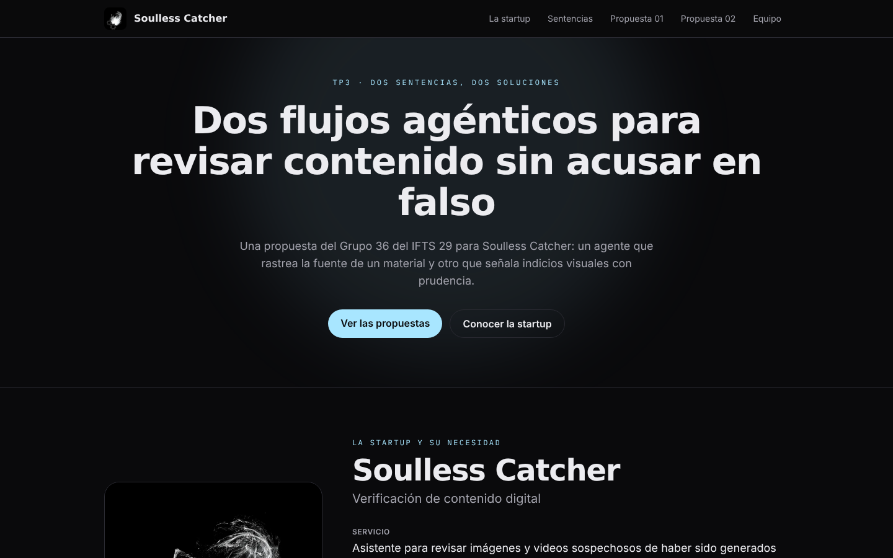
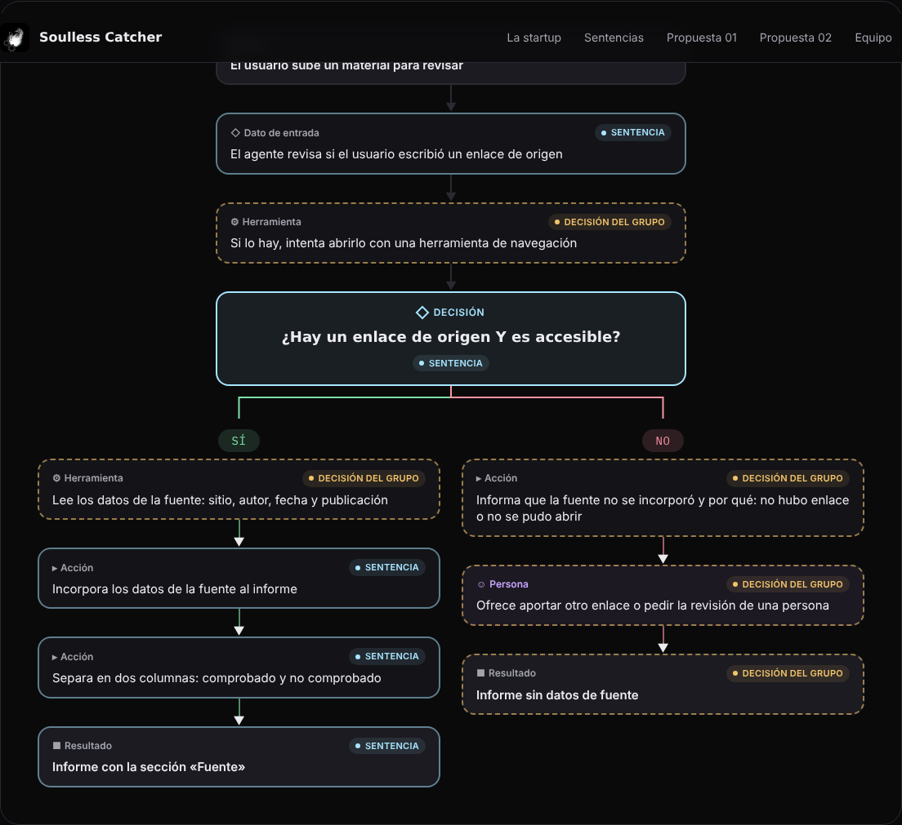
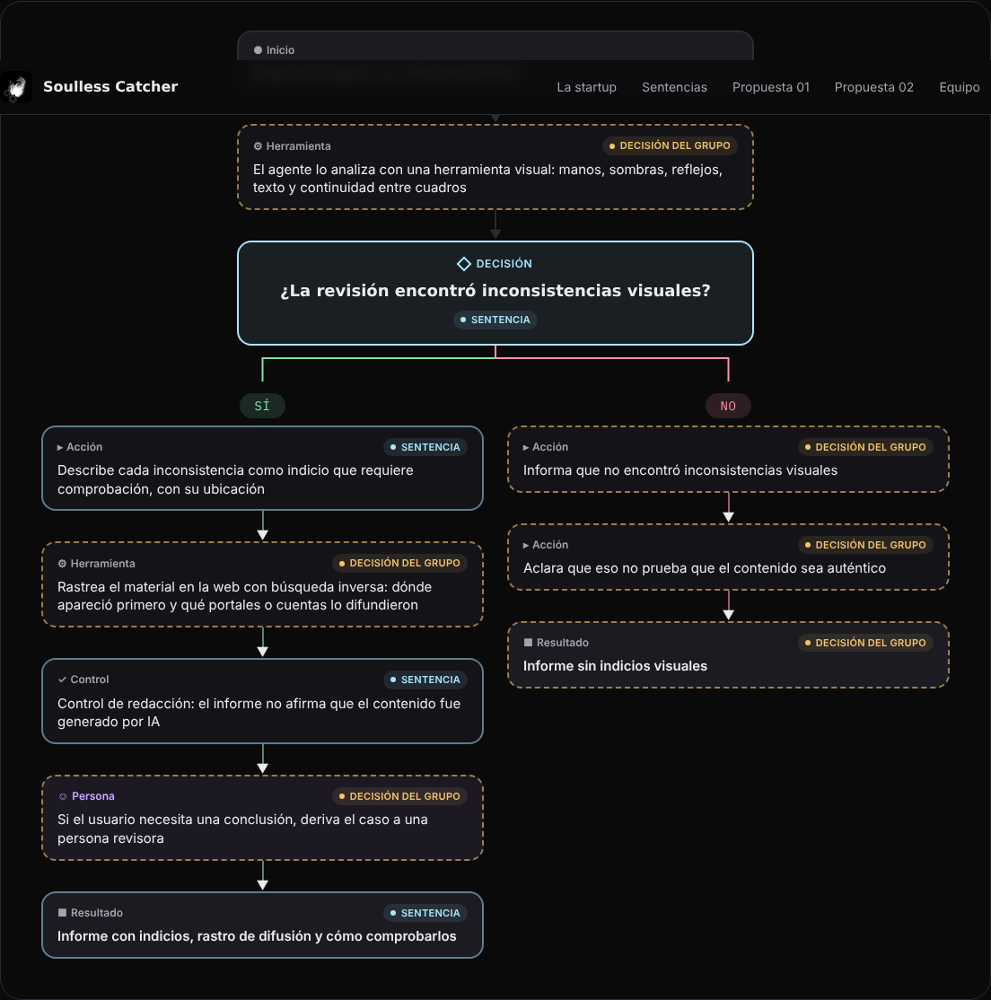

# TP3 · Dos sentencias, dos soluciones · Grupo 36

Landing con dos propuestas de flujos agénticos para **Soulless Catcher**, una startup creada por estudiantes del IFTS 16. TP3 de Frontend, Desarrollo de Sistemas Web, IFTS 29, 2026.

🔗 **Landing publicada:** https://tp3-soulless-catcher.vercel.app _(completar con el enlace final de Vercel)_
📦 **Repositorio:** https://github.com/julietanatbravo/tp3-soulless-catcher



## Índice

- [Grupo e integrantes](#grupo-e-integrantes)
- [Startup y bloque asignado](#startup-y-bloque-asignado)
- [Las dos sentencias desarmadas](#las-dos-sentencias-desarmadas)
- [Las dos propuestas](#las-dos-propuestas)
- [Qué tiene la landing](#qué-tiene-la-landing)
- [Herramientas de IA, aplicaciones y modelos](#herramientas-de-ia-aplicaciones-y-modelos)
- [Evidencia de iteración](#evidencia-de-iteración)
- [Cómo correrlo](#cómo-correrlo)
- [Comprobación de enlaces y funcionamiento](#comprobación-de-enlaces-y-funcionamiento)

## Grupo e integrantes

**Grupo 36.** Esta entrega es individual, con el acuerdo del docente, igual que el TP2.

| Integrante | GitHub | Aporte |
| --- | --- | --- |
| Julieta Natalia Bravo | [@julietanatbravo](https://github.com/julietanatbravo) | Todo el trabajo: análisis de las dos sentencias, definición de las propuestas y de los supuestos agregados, instrucciones y correcciones al agente, revisión de los flujos, pruebas en desktop, publicación y documentación |

## Startup y bloque asignado

| | |
| --- | --- |
| Startup | **Soulless Catcher** (creada en el IFTS 16) |
| Rubro | Verificación de contenido digital |
| Objetivo | Asistente para revisar imágenes y videos sospechosos de haber sido generados con IA |
| Asignación | Sorteo docente **S04-B** |
| Bloque | **Fuentes e indicios** · frases R3 y R4 |

El logo original se tomó del material asignado y está en [`public/soulless-catcher-logo.png`](public/soulless-catcher-logo.png).

## Las dos sentencias desarmadas

**R3.** «Si el usuario aporta un enlace de origen accesible, el sistema incorpora al informe los datos de esa fuente y distingue lo comprobado de lo no comprobado.»

| Datos necesarios | Condición | Consecuencia |
| --- | --- | --- |
| Enlace aportado, si se puede abrir, datos de la fuente (sitio, autor, fecha), informe en curso | Hay enlace **Y** es accesible | Incorporar los datos de la fuente **Y** separar comprobado de no comprobado |

**R4.** «Si la revisión encuentra inconsistencias visuales, el sistema las describe como indicios que requieren comprobación, sin afirmar por eso que el contenido fue generado por IA.»

| Datos necesarios | Condición | Consecuencia |
| --- | --- | --- |
| Material, inconsistencias encontradas y su ubicación (zona o minuto) | Hay al menos una inconsistencia visual | Describirlas como indicios **Y NO** afirmar que es IA |

## Las dos propuestas

| Sentencia | Propuesta | Beneficio | Caso límite |
| --- | --- | --- | --- |
| R3 | **Rastreador de origen** | El informe muestra quién publicó el material, cuándo y dónde, separando certezas de suposiciones | El enlace abre pero muestra otro material: los datos van a «No comprobado» y se deriva a una persona |
| R4 | **Lector de indicios** | Lista concreta de qué mirar y dónde, y por dónde circuló el material (por ejemplo, qué portal lo difundió primero), sin un veredicto que puede ser falso | Un defecto que puede deberse a la compresión: se describe con su explicación alternativa |

En los diagramas, el borde continuo marca lo que establece la sentencia y el borde punteado marca las decisiones del grupo, es decir, lo que la regla no define. Por ejemplo, qué pasa si no hay enlace o si no aparecen inconsistencias.

| Rastreador de origen (R3) | Lector de indicios (R4) |
| --- | --- |
|  |  |

## Qué tiene la landing

- **La startup:** nombre, logo original completo, servicio, problema, asignación, bloque y origen en el IFTS 16.
- **Sentencias desarmadas:** ficha de cada una, con datos, condición, consecuencia y una nota sobre los conectores («y», negación).
- **Dos propuestas:** título, sentencia original, beneficio y diagrama de flujo hecho con HTML, CSS y SVG.
- **Recorrer un caso:** botones que resaltan en el diagrama el camino de un ejemplo que cumple la condición y de otro que no la cumple.
- **Desplegables** con `<details>`, que se abren con clic o con teclado (Tab y Enter): datos de entrada, decisión, acción, resultado, excepciones e intervención humana, y caso límite.
- **Navegación** fija con enlaces a cada sección y un enlace para saltar al contenido.

La landing no ejecuta agentes ni se conecta a ninguna API: los flujos son una propuesta.

**Tecnologías:** React 19, Vite 6, Tailwind CSS v4 y deploy en Vercel.

**Tipografías:** Verdana para los títulos (con DejaVu Sans y Tahoma de respaldo), IBM Plex Mono para las etiquetas e Inter para el texto. IBM Plex Mono está dentro del proyecto, en `public/fonts`, con licencia OFL.

## Herramientas de IA, aplicaciones y modelos

La construcción fue 100% agéntica: el código lo generó y lo modificó el agente, y yo lo dirigí con instrucciones y revisiones, sin editarlo a mano.

| Aplicación | Modelo | Para qué se usó |
| --- | --- | --- |
| Claude (app de escritorio) | Claude Opus 5.5 | Leer la consigna, extraer la asignación del grupo 36 y su logo del PDF, generar todo el código del proyecto, revisar la página con capturas, corregir errores y redactar este README |

Las decisiones fueron mías: qué agrega cada propuesta más allá de la regla, los casos de prueba, la intervención humana y los casos límite. Revisé cada flujo contra su sentencia.

## Evidencia de iteración

| # | Instrucción o revisión | Problema detectado | Pedido de mejora y qué cambió |
| --- | --- | --- | --- |
| 1 | Encargo inicial: la consigna del TP3, la asignación del grupo 36 y React + Vite + Tailwind | — | Se generó la estructura, el contenido, los dos diagramas y los desplegables |
| 2 | Revisión de las capturas de los diagramas | Las líneas de la bifurcación no caían sobre las columnas SÍ y NO, y los nodos de inicio decían «Inicio: Inicio:» | Se pidió alinear las líneas con el centro de cada columna y quitar el prefijo repetido. Ahora el recorrido se lee sin saltos |
| 3 | Revisión del flujo R3 contra la sentencia | El inicio suponía que siempre había enlace, pero el caso «no hay enlace» también lleva al camino NO | Se cambió el inicio a «el usuario sube un material» y se sumó el paso que revisa si hay enlace |
| 4 | Revisión del diseño | Las tipografías de los títulos se parecían demasiado al diseño de la consigna | Se pidió cambiarlas y no seguir al pie de la letra la estética de la consigna. Primero se probó Instrument Serif, una serif editorial. Después pedí una tipografía similar a Verdana, más clara y directa: los títulos quedaron en Verdana y las etiquetas en IBM Plex Mono |
| 5 | Revisión del flujo R4 | Cuando hay indicios, el informe no decía de dónde salía el material ni quién lo había difundido | Se pidió que el agente rastree la imagen en la web y avise, por ejemplo, si la difundió un portal. Se sumó un paso de búsqueda inversa, marcado como decisión del grupo, que informa la primera aparición y los portales. Se cuidó que el rastro se presente como dato y no como prueba de que es IA, para no contradecir la regla |
| 6 | _Completar con mi revisión en el navegador_ | | |

## Cómo correrlo

Requisitos: Node.js 20 o superior y npm.

```bash
git clone https://github.com/julietanatbravo/tp3-soulless-catcher.git
cd tp3-soulless-catcher
npm install
npm run dev
```

| Comando | Descripción |
| --- | --- |
| `npm run dev` | Servidor de desarrollo |
| `npm run build` | Versión de producción en `dist/` |
| `npm run preview` | Sirve la versión de producción |

## Comprobación de enlaces y funcionamiento

Probado en desktop, desde una ventana sin sesión:

- [ ] El repositorio abre sin iniciar sesión
- [ ] La landing abre sin iniciar sesión y muestra la versión final
- [ ] El logo se ve completo y los dos diagramas se leen bien
- [ ] Los desplegables se abren y se cierran con clic y con Tab + Enter
- [ ] En cada flujo, los dos casos (se cumple / no se cumple) resaltan el camino correcto
- [ ] No hay desbordes horizontales a 1366 px y a 1920 px de ancho
